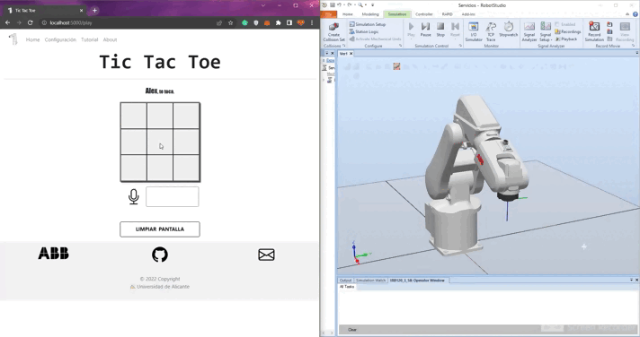

# Tic-Tac-Toe with an ABB IRB 120

> University team project, 2022–2023, University of Alicante.
> Republished from the team's original repository: https://github.com/nachoperezzv/TicTacToe-with-ABB



A person plays tic-tac-toe in a browser, by click or by voice, against another player or a minimax CPU. Each move is sent over TCP to an ABB IRB 120 in RobotStudio, which moves to the chosen board cell.

## Why it is interesting

It joins three layers: a web interface, a speech-to-intent model and an industrial robot program in RAPID, linked by a small custom socket protocol.

## Stack

- **Backend:** Python, Flask
- **Game AI:** minimax over the remaining empty cells
- **Voice:** browser `webkitSpeechRecognition` (`es-ES`), then Hugging Face `transformers` zero-shot classification with `facebook/bart-large-mnli`
- **Frontend:** HTML, CSS, JavaScript, Bootstrap 5 (CDN)
- **Robot:** RAPID, RobotStudio, RobotWare 6.13, IRB 120-3/0.6, Multitasking option

## How it works

```
Browser (click or voice)
   │  fetch: /play/move, /play/getIntention
   ▼
Flask (src/app.py) ── ThreeInRow → Tablero → Player     game rules, minimax
   │  TCP client (src/utils/tcp.py), message e.g. "J1;A1"
   ▼
RAPID task Com (port 4000) ── receive, ack, store in a persistent variable
   │
   ▼
RAPID task Motion ── parse message, move HOME → cell → HOME
```

- **Game:** each player has five tokens and a placed token cannot move. The CPU picks a random cell on an empty board, otherwise it runs minimax to full remaining depth.
- **Voice:** the final transcript goes to `/play/getIntention`, which classifies it against the nine labels `A1`–`C3` and sends the top label to the robot socket.
- **Protocol:** `J` is player 1 and `Q` is player 2, followed by token number and cell. For example, `J1;A1` is player 1's first token to A1.

### Current limits

- In the packaged RAPID `Motion` module, the pick step, the gripper output and the end-of-game collection are commented out, so the robot moves to the target cell without handling a piece.
- The configuration page posts to `/configuracion/setABBconfig`, while the Flask route is `/configuration/setABBconfig`, so it does not change the robot address.
- Addresses are hard-coded from the final setup; see the run steps.

## Results

The animation above shows a game driving the robot in simulation. `Motion.mod` also holds targets labelled as recorded on the real robot. The repository holds no measurements.

## How to run

These steps come from the files in the repository; they were not re-run for this publication. The pinned `requirements.txt` includes `tensorflow-intel`, so it targets Windows, and the pins fit Python 3.9 or 3.10.

1. Install the dependencies:
   ```
   python -m venv .venv
   .venv\Scripts\activate
   pip install -r requirements.txt
   ```
2. For a local run, change the default `host='192.168.125.1'` in `src/utils/tcp.py` to `host='127.0.0.1'`, the address the RAPID `Com` module binds. The web app and front end already use `127.0.0.1`.
3. In RobotStudio, create an IRB120 station, load `RAPID/Motion.mod` and `RAPID/Com.mod`, then start the simulation so the socket listens on port 4000. The original station package is not included in this repository.
4. Start the app; the first run downloads the classification model:
   ```
   cd src
   python app.py
   ```
5. Open http://localhost:5000. Voice input needs a browser with `webkitSpeechRecognition` and internet access.

For the real robot, transfer the task to the controller and use its address in the Python TCP client and in the `SocketBind` calls in `Com.mod`.

## Repository layout

```
src/app.py              Flask routes
src/utils/              Game logic (player, tablero, threeinRow), TCP client
src/templates, static/  Web interface and assets
RAPID/                  RobotStudio Pack & Go station; Motion.mod and Com.mod as plain text
TUTORIAL.md             User guide (Spanish)
custom.py, logger.py    Exception type and path helper
log/                    Runtime log folder
```

## Team and credits

Commit authors: [alejandrorubioo](https://github.com/alejandrorubioo), Ignacio Perez ([nachoperezzv](https://github.com/nachoperezzv)), Pablo Martínez Juan.

Alejandro Rubio (alejandrorubioo) shared design, development and implementation on equal terms with the team.

All rights remain with the authors; a licence is pending.
